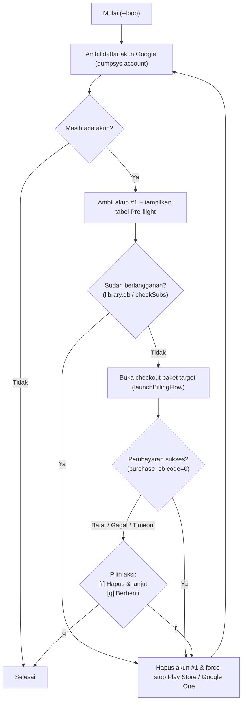

# 🚀 Google One Billing Injector (`gemini-pro-frida`)

Alat otomasi berbasis **Python + Frida** untuk menguji alur *Google Play Billing* pada aplikasi **Google One** di perangkat Android atau emulator (MuMu, LDPlayer, Nox, AVD) yang sudah di-root.

> [!NOTE]
> Skrip ini **tidak pernah menekan tombol Subscribe / Bayar secara otomatis**. Eksekusi selalu berhenti di layar konfirmasi pembayaran Google Play agar pengguna mengonfirmasi secara manual.

---

## ✨ Fitur Utama

- **Deteksi Lingkungan Otomatis** — Mencari `adb`, menghubungkan port emulator umum (`7555`, `16384`, `5555`, dll.), menyinkronkan `frida-server` sesuai ABI, dan menyuntikkan `module_521.apk` (`BillingClient 5.2.1`).
- **Dukungan Root Ganda (`su` & `adb root`)** — Berjalan di perangkat dengan `su` klasik maupun emulator Android 15 seperti **MuMu Player** (`adb root` + `setsid`).
- **Auto-Remove Pasca-Pembayaran** — Memantau callback `onPurchasesUpdated` (`purchase_cb code=0`) dan otomatis menghapus akun Google via `AccountManagerService` setelah pembayaran sukses.
- **Mode Loop Multi-Akun (`--loop`)** — Memproses beberapa akun Google secara berurutan:
  - Jika akun terdeteksi sudah berlangganan (`library.db` atau live `queryPurchasesAsync`), akun langsung dihapus dan lanjut ke akun berikutnya.
  - Jika belum berlangganan, memunculkan layar checkout, menunggu pembayaran sukses, menghapus akun, lalu lanjut ke akun selanjutnya.
- **Audit Offer Tanpa Checkout (`--check-offers`)** — Mengecek ketersediaan SKU, `offerId`, dan harga dari Play Store dalam satu tabel ringkas tanpa memunculkan popup pembayaran.
- **Structured Audit Log (`--log-file`)** — Menyimpan log per langkah dalam format **JSONL** untuk keperluan QA dan pelacakan hasil.

---

## 🔄 Alur Kerja Mode Loop (`--loop`)



---

## ⚡ Quick Start

### 1. Prasyarat
- **PC**: Python 3.10+ dan `adb` (Android SDK Platform-Tools atau bawaan emulator).
- **Perangkat / Emulator Android**:
  1. **Root aktif** (`su` atau **Root permission** di MuMu Settings).
  2. Minimal 1 **akun Google** sudah login.
  3. Aplikasi **Google One** (`com.google.android.apps.subscriptions.red`) terinstal dari Play Store.

### 2. Instalasi
```powershell
git clone https://github.com/ardianrifendy/gemini-pro-frida.git
cd gemini-pro-frida
python -m pip install -r requirements.txt
```

*(Disarankan memakai `frida==17.9.1` dan `frida-tools==14.8.1` jika Anda memakai binary cache lokal `frida-server-17.9.1`; jika tidak ada di `assets/`, skrip otomatis mengunduh `frida-server` yang cocok dari rilis GitHub Frida.)*

### 3. Jalankan
```powershell
# Mode menu interaktif
python main.py

# Langsung buka checkout pro_12m
python main.py --plan pro_12m

# Buka checkout + tunggu pembayaran + auto-remove akun
python main.py --plan pro_12m --auto-remove

# Loop otomatis untuk semua akun yang sudah login di perangkat
python main.py --plan pro_12m --loop

# Audit ketersediaan offer & harga semua paket tanpa membuka checkout
python main.py --check-offers
```

---

## 🛠️ Referensi Lengkap

<details>
<summary><b>📋 Opsi Command Line (CLI Flags)</b> — klik untuk buka</summary>

| Flag | Default | Fungsi |
|---|---|---|
| `-s`, `--serial` | Auto | Menentukan serial ADB perangkat target (mis. `emulator-5554`) |
| `--plan <id/nomor>` | - | Langsung menjalankan paket tertentu tanpa masuk ke menu |
| `--stack-plans <a,b,...>` | - | Rantai tumpuk payment (langkah 1 otomatis *new* jika belum punya sub, langkah 2+ otomatis *stack* `mode=5`) |
| `--stack`, `--renew` | `false` | Mode perpanjangan/stacking (`ReplacementMode = 5`) ke langganan aktif |
| `--addon <id>` | - | Menggabungkan add-on YouTube (`yt_1m`, `yt_family`, `yt_lite`) |
| `--loop` | `false` | Memproses semua akun Google yang login di perangkat secara berurutan |
| `--check-offers` | `false` | Mengecek ketersediaan semua SKU/offer dan harganya tanpa checkout |
| `--log-file <path>` | - | Menulis log terstruktur ke file `.jsonl` |
| `--wait-payment <detik>` | `300.0` | Batas waktu menunggu konfirmasi pembayaran user |
| `--auto-remove` | `false` | Otomatis menghapus akun Google setelah pembayaran sukses (`code=0`) |
| `--wait <detik>` | `8.0` | Lama tunggu setelah `buy` saat mode default (`auto-remove` mati) |
| `--remove-accounts` | `false` | Langsung menghapus seluruh akun `com.google` di perangkat lalu keluar |

Contoh lanjutan:
```powershell
# Renew / stacking di atas langganan yang sudah ada
python main.py --renew --plan pro_6m

# Simpan log audit ke file JSONL saat menjalankan loop
python main.py --plan pro_12m --loop --log-file audit.jsonl

# Hanya buka checkout tanpa auto-remove
python main.py --plan pro_12m

# Buka checkout lalu auto-remove akun setelah bayar sukses
python main.py --plan pro_12m --auto-remove

# Hapus semua akun Google di emulator saat ini
python main.py --remove-accounts
```

</details>

<details>
<summary><b>🎮 Panduan Tombol Menu Interaktif</b> — klik untuk buka</summary>

| Input | Aksi |
|---|---|
| `1`–`28` atau nama paket | Memicu layar checkout Play Store untuk paket tersebut |
| `s` | Toggle mode **Pembelian Baru** (`STACK=false`) ↔ **Renew/Stacking** (`STACK=true`) |
| `t` | **Tumpuk Payment** berantai pada satu akun (mis. `pro_12m,pro_6m_2,pro_6m`) |
| `a` | Memilih add-on YouTube Premium (`yt_1m`, `yt_family`, `yt_lite`) |
| `r` | Toggle **Auto-Remove akun** setelah pembayaran sukses |
| `p` | Memulai mode **Loop** untuk semua akun Google di perangkat |
| `o` | Menjalankan **Offer Audit** (`--check-offers`) dari dalam menu |
| `x` | Menghapus seluruh akun Google yang sedang login sekarang juga |
| `e` | Menjalankan ulang pengecekan environment & perangkat |
| `g` | Me-restart aplikasi Google One dan menyuntikkan ulang Frida |
| `l` | Menampilkan ulang daftar menu paket |
| `q` | Keluar dari program |

</details>

<details>
<summary><b>📦 Daftar 28 Paket (<code>plans.json</code>)</b> — klik untuk buka</summary>

Katalog dikelola terpusat di [plans.json](plans.json) dan otomatis disinkronkan ke `frida.js`:

- **Plus (12 paket)**:
  - Trial gratis (`g1.play.helium`): `helium_12m`, `helium_6m`, `helium_3m`, `helium_1m`
  - Trial gratis (`g1.2tb.*`): `plus_6m`, `plus_3m`, `plus_2tb_6m`
  - Intro price: `helium_3m_75`, `plus_2tb_85`
  - YouTube add-on: `yt_1m`, `yt_family`, `yt_lite`
- **Pro (8 paket)**:
  - Pro 5TB trial: `pro_12m`, `pro_6m`, `pro_6m_2`, `pro_6m_ss`, `pro_play_3m`
  - Pro 5TB / 10TB intro price: `pro_3m_75`, `pro10_1m_90`, `pro10_3m_85`
- **Ultra 5x – 20TB (3 paket)**: `ultra20_3m_90`, `ultra20_3m_80`, `ultra20_3m_75`
- **Ultra 20x – 30TB (5 paket)**: `ultra_1m_90`, `ultra_3m_90`, `ultra_3m_80`, `ultra_1m_75`, `ultra_3m_75`

</details>

<details>
<summary><b>📂 Struktur File Proyek</b> — klik untuk buka</summary>

| File / Folder | Deskripsi |
|---|---|
| `main.py` | Entrypoint CLI, deteksi ADB/device, manajemen sesi Frida, loop, dan auto-remove akun |
| `frida.js` | Payload Frida untuk inisialisasi `BillingClient`, query offer, check subs, dan `launchBillingFlow` |
| `plans.json` | Konfigurasi grup dan 28 SKU/offer Google One |
| `module_b64.py` | Payload base64 `BillingClient 5.2.1` (`module_521.apk`) |
| `tests/test_main.py` | Unit test (`unittest`) untuk katalog, deduplikasi ADB, pengecekan `library.db`, state sesi, dan audit logger |
| `requirements.txt` | Dependensi Python (`frida`, `frida-tools`) |
| `assets/` | Cache lokal binary `frida-server` (diabaikan oleh `.gitignore`) |

</details>

<details>
<summary><b>❓ Troubleshooting Cepat</b> — klik untuk buka</summary>

- **Root tidak terdeteksi di MuMu Android 15**: Pastikan **Root permission** aktif di Settings MuMu lalu restart emulator; `main.py` otomatis memakai `adb root` jika binary `su` tidak tersedia di shell.
- **Layar checkout tidak muncul / salah akun saat banyak akun login**: Gunakan `--loop` atau pastikan hanya akun target yang aktif di Play Store (`main.py` akan me-*force-stop* Play Store & Google One setiap kali akun dihapus di mode loop).
- **Mode `--renew` gagal (`no_purchase`)**: Akun yang sedang aktif belum memiliki langganan Google One yang bisa di-*stack*; jalankan tanpa `--renew` untuk pembelian baru.

</details>

---

## 🧪 Pengujian

```powershell
python -m unittest discover -s tests -v
```
